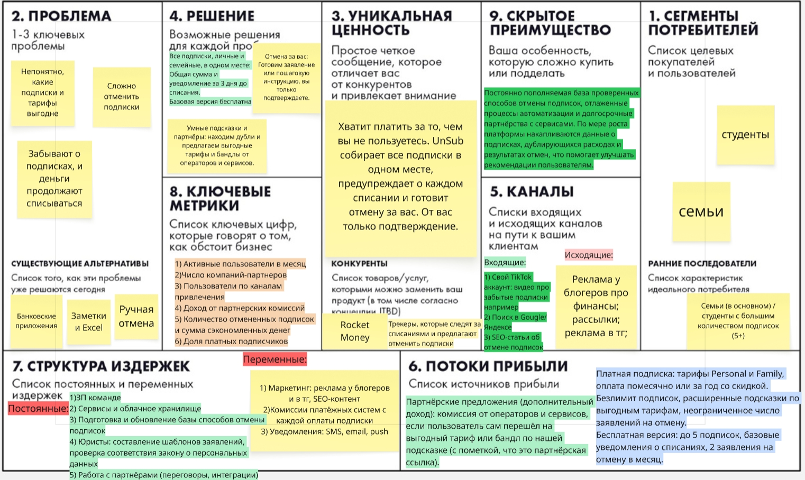

# UnSub

**Платформа, которая собирает все подписки в одном месте, предупреждает о списаниях и помогает их отменять.**

**Бизнес-модель: B2C + B2B2C**

---

## Elevator Pitch

Большинство семей и студентов платят за подписки, о которых давно забыли. Бесплатный пробный период закончился, а деньги продолжают списываться. Отменить некоторые подписки можно только через письмо или заявление, и многие на этом сдаются. В итоге до нескольких десятков тысяч рублей в год уходит впустую.

Мы разработали **UnSub**: платформу, которая собирает все ваши подписки в одном месте, будь то личные или семейные. Она автоматически следит за старыми и новыми подписками, показывает, сколько вы платите в сумме, и заранее предупреждает о каждом предстоящем списании, чтобы вы успели принять решение.

Главное отличие UnSub от обычных трекеров в том, что мы не останавливаемся на списке. UnSub работает для всей семьи сразу, находит дубли и подсказывает, от чего можно отказаться и какие тарифы выгоднее. Мы выстраиваем партнёрства с операторами и сервисами, которые предлагают нашим пользователям выгодные условия. А если сервис требует официального заявления, UnSub сам подготовит его за вас. Вам остаётся только подтвердить отправку.

В результате вы перестаёте переплачивать, экономите деньги и время и наконец понимаете, на что уходит бюджет.
Хотите узнать, сколько денег вы теряете на забытых подписках? Попробуйте UnSub и проверьте это уже сегодня.

## Lean Canvas

