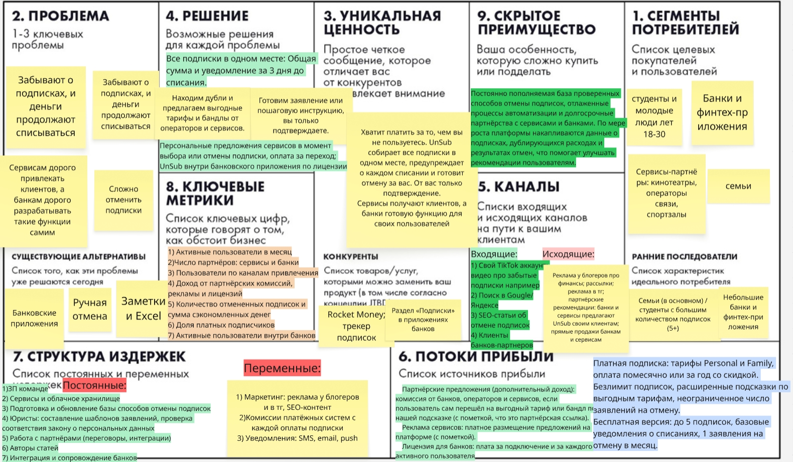

# UnSub

**Платформа, которая собирает все подписки в одном месте, предупреждает о списаниях и помогает их отменять.**

**Бизнес-модель: B2C (в pivot B2B2C + B2B)**

---

## Elevator Pitch

Большинство семей и студентов платят за подписки, о которых давно забыли. Бесплатный пробный период закончился, а деньги продолжают списываться. Отменить некоторые подписки можно только через письмо или заявление, и многие на этом сдаются. В итоге до нескольких десятков тысяч рублей в год уходит впустую.

Мы разработали **UnSub**: платформу, которая собирает все ваши подписки в одном месте, будь то личные или семейные. Она автоматически следит за старыми и новыми подписками, показывает, сколько вы платите в сумме, и заранее предупреждает о каждом предстоящем списании, чтобы вы успели принять решение.

Главное отличие UnSub от обычных трекеров в том, что мы не останавливаемся на списке. UnSub работает для всей семьи сразу, находит дубли и подсказывает, от чего можно отказаться и какие тарифы выгоднее. Мы выстраиваем партнёрства с операторами и сервисами, которые предлагают нашим пользователям выгодные условия. А если сервис требует официального заявления, UnSub сам подготовит его за вас. Вам остаётся только подтвердить отправку.

В результате вы перестаёте переплачивать, экономите деньги и время и наконец понимаете, на что уходит бюджет.
Хотите узнать, сколько денег вы теряете на забытых подписках? Попробуйте UnSub и проверьте это уже сегодня.

## Lean Canvas

---
 
## HADI-гипотеза
 
### Самый критичный риск: риск ценности
 
Из четырёх рисков по Марти Кагану для UnSub самым критичным мы считаем риск ценности: пользователи могут не захотеть платить за приложение, которое помогает им экономить, а после первой чистки подписок могут перестать им пользоваться. В нашем Lean Canvas этот риск относится к блокам 3 (уникальная ценность) и 6 (потоки прибыли).
 
Этот риск главный, потому что от него зависят остальные. Например, жизнеспособность строится на конверсии в платных пользователей и на удержании, а если людям продукт не нужен, никакая экономика не сойдётся. Поэтому сначала мы проверяем, будут ли люди за это платить.
 
### HADI
 
**(H) Гипотеза**
 
Мы верим, что молодые люди 18-30 лет (в том числе студенты) и семьи с 5+ подписками готовы платить за Personal-версию UnSub (249 ₽ в месяц), которая следит за подписками и готовит отмену.
 
**(A) Действие**
 
Мы сделаем лендинг UnSub с описанием продукта, ценой 249 ₽ в месяц и кнопкой “Попробовать Personal”. По кнопке человек оставляет e-mail и видит сообщение “Мы запускаемся, вы в списке”. Уже после этого показываем необязательные вопросы: “Сколько вам лет?”, “Вы учитесь или работаете?”, “Вам нужна семейная подписка?” и “Сколько у вас подписок?”. Так лишние вопросы не снижают число заявок. Запустим рекламу на 10 000 ₽ в двух каналах: 5 000 ₽ в Telegram-каналах про финансы и 5 000 ₽ в Яндекс Директе по запросам об отмене подписок. На лендинге покажем вопрос “Почему вы не хотите попробовать?” тем, кто уходит без заявки. После теста проведём 5-10 коротких интервью с теми, кто оставил заявку, и ещё 5 с людьми из нашей аудитории, которые не оставили заявку или не видели лендинг: покажем им страницу и спросим, что их останавливает.
 
**(D) Данные**
 
Мы замерим количество посетителей лендинга, стоимость клика, количество заявок и стоимость одной заявки, отдельно по каналам (Telegram и Директ) и по сегментам (молодые люди и семьи). Также соберём ответы на вопрос “Почему вы не хотите попробовать?” и результаты интервью.
 
**(I) Вывод**
 
Если мы получим не менее 15 заявок при стоимости заявки не выше 700 ₽, гипотеза подтверждена. Если заявок меньше 15 или заявка дороже 700 ₽, людям не нужен платный UnSub, и мы переходим к pivot. Ответы на вопрос “Почему вы не хотите попробовать?” и результаты интервью покажут причины: цену, недоверие или отсутствие потребности. Они помогут понять, что именно менять. Заявка по e-mail это верхняя оценка спроса, потому что оставить контакт проще, чем заплатить.
 
---
 
## Юнит-экономика
 
За единицу расчёта принимается один платящий подписчик.
 
### 1. Расчёт стоимости привлечения клиента (CAC)
 
Стоимость клика: 30 рублей. Это среднее между платным и бесплатным трафиком. Около половины трафика платное (реклама в Яндекс Директе стоит около 45 рублей за клик, плюс реклама в Telegram-каналах про финансы стоит около 70 рублей), а другая половина бесплатная (SEO-статьи об отмене подписок, приглашения от семьи, около 7 рублей за клик).
 
Конверсия в регистрацию: 15% людей переходят по рекламе и создают бесплатный аккаунт.
 
30 / 0,15 = 200 рублей. Столько стоит одна регистрация.
 
Конверсия из регистрации в платную подписку: 5%.
 
**Итого CAC: 200 / 0,05 = 4 000 рублей.**
 
### 2. Расчёт прибыли с клиента за всё время (LTV)
 
Правила подписок:
 
- **Бесплатная версия:** до 5 подписок, базовые уведомления, 1 заявление на отмену в месяц. Без семейного доступа и расширенных подсказок. Партнёрские предложения видят все пользователи.
- **Personal:** 249 рублей в месяц, один человек, безлимит подписок и отмен.
- **Family:** 399 рублей в месяц, до 4 человек. Каждое дополнительное место стоит +49 рублей в месяц, максимум 6 человек (семья из 5 человек платит 448 рублей, из 6 человек 497 рублей).
- **Годовая оплата** со скидкой.
Стоимость подписки: Personal берут 60% платящих клиентов, Family 40%. Средний чек Family около 430 рублей (семьи из 4, 5 и 6 человек). Средний чек: 0,6 × 249 + 0,4 × 430 ≈ 320 рублей в месяц.
 
Вычитаем издержки: около 15% уходит на комиссии платёжных систем, поддержку и уведомления. Чистая прибыль с клиента составляет 85%: 320 × 0,85 = 272 рубля в месяц.
 
Срок жизни платящего клиента: 7 месяцев (отток около 14% в месяц). После первой чистки подписок часть людей перестаёт нуждаться в сервисе, а годовая оплата со скидкой и семейный тариф удерживают остальных.
 
LTV от подписки: 272 × 7 = 1 904 рубля.
 
Партнёрский доход: 3% зарегистрированных пользуются партнёрским предложением, комиссия 300 рублей, то есть 9 рублей с одной регистрации. На одного платящего клиента приходится 20 регистраций (1 / 0,05), значит, партнёрский доход составляет 180 рублей.
 
**Итого LTV: 1 904 + 180 = 2 084 рубля.**
 
### 3. Сходимость экономики
 
**LTV / CAC = 2 084 / 4 000 = 0,52**
 
Здоровым считается значение от 3, минимально допустимым 1.
 
Окупаемость: 4 000 / 272 ≈ 15 месяцев, а клиент остаётся в среднем на 7.
 
**Вывод:** экономика изначального плана не сходится. Привлечение платящего клиента обходится в 4 000 рублей, а он приносит около 2 080 рублей за всё время. Чтобы модель заработала, нужно снизить стоимость привлечения в 2 раза или поднять удержание и чек. Реальные значения конверсий и оттока покажет тест из HADI. Это означает, что нужно сделать pivot.
 
---
 
## Pivot
 
### Тип пивота
 
**Platform Pivot** (переход от приложения для одного человека к платформе, которая связывает пользователей, сервисы и банки). Вместе с этим меняются модель дохода (к подписке добавляются платежи сервисов и лицензии банков) и канал привлечения (партнёры и статьи вместо платной рекламы).
 
### Обоснование
 
Расчёт юнит-экономики показал, что изначальный план не сходится: привлечение платящего клиента стоит около 4 000 рублей, а он приносит около 2 080 рублей, то есть LTV / CAC равно 0,52 при минимально допустимом значении 1. Причины две: платный трафик дорогой, а с одного человека мы получаем в основном только подписку, партнёрский доход пока небольшой.
 
Платформа меняет обе. Пользователей приводят статьи, партнёры и банки, поэтому стоимость привлечения падает. А доход с одного пользователя складывается из нескольких источников, а не из одной подписки.
 
Кроме того, в России действует закон, который обязывает сервисы давать возможность отказаться от подписки в электронной форме. Отмена становится проще, поэтому главная ценность платформы смещается от самой отмены к выбору выгодных предложений.
 
### Как устроена новая модель
 
UnSub становится единым агрегатором подписок из любых сфер: кино, музыка, связь, спорт, обучение, софт. Пользователь видит всё в одном месте, а сервисы и банки платят за клиентов и за подключение.
 
1.  UnSub анализирует подписки пользователя (с его согласия), показывает, за что он переплачивает, и предлагает более выгодные варианты у других сервисов: онлайн-кинотеатры, операторы связи, спортзалы и другие. Подписки добавляются вручную или загрузкой выписки, а внутри банка в приложении банка. Всё только с согласия пользователя, по закону о персональных данных.
2.  Пользователь выбирает лучшее предложение и переходит к сервису. Если подписка не нужна, UnSub готовит отмену.
3.  Сервисы соревнуются за клиента в момент выбора. Даже небольшие компании получают клиентов без большого рекламного бюджета. Партнёрские предложения всегда помечаются, а первым показывается самое выгодное для пользователя.
4.  Банки подключают UnSub к своему приложению по лицензии. Банк получает готовый инструмент для клиентов, а мы получаем больше пользователей.
### Источники дохода
 
1.  Платная подписка (платят пользователи). Бесплатная версия: до 5 подписок, базовые уведомления, 1 заявление на отмену в месяц. Без семейного доступа и расширенных подсказок. Personal: 249 рублей в месяц, один человек. Family: 399 рублей в месяц, до 4 человек, дополнительное место +49 рублей, максимум 6 человек.
2.  Плата сервисов за каждого клиента, который перешёл к ним по нашей подсказке.
3.  Реклама и платное размещение сервисов на платформе (с пометкой).
4.  Лицензия для банков: фиксированная плата за подключение и плата за активного пользователя внутри банка.
### Как привлекаем пользователей
 
1.  Статьи: 2-3 автора пишут материалы про подписки и отмену, которые приводят людей из поиска.
2.  Банки: после подключения UnSub клиенты банка становятся нашими пользователями.
3.  Партнёры: сервисы сами рассказывают своим клиентам, что у них можно найти выгодное предложение через UnSub. Это тоже наша реклама, а соперничество между сервисами делает платформу заметнее.

### Юнит-экономика для pivot

Правила подписок и средний чек те же, что в изначальном плане. Меняются трафик, конверсии и доходы с партнёров. За единицу расчёта принимается один платящий подписчик.

#### 1. Расчёт стоимости привлечения клиента (CAC)

Стоимость клика: 14 рублей. Теперь 80% трафика бесплатное (статьи, банки, партнёры, в среднем около 5 рублей за клик), а платная реклама составляет только 20% (около 50 рублей за клик): 0,8 × 5 + 0,2 × 50 = 14.

Конверсия в регистрацию: 25%. Люди из банков и от партнёров уже доверяют источнику, поэтому регистрируются чаще.

14 / 0,25 = 56 рублей. Столько стоит одна регистрация.

Конверсия из регистрации в платную подписку: 5%.

**Итого CAC: 56 / 0,05 = 1 120 рублей.**

#### 2. Расчёт прибыли с клиента за всё время (LTV)

Подписка: 272 × 7 = 1 904 рубля (как в изначальном плане).

Партнёрский доход: партнёрские предложения теперь главная часть продукта, ими пользуются 20% зарегистрированных, комиссия 300 рублей, то есть 60 рублей с одной регистрации. На одного платящего клиента приходится 20 регистраций (1 / 0,05), значит, партнёрский доход составляет 1 200 рублей.

Платное размещение сервисов: около 10 рублей с одной регистрации, то есть 200 рублей на одного платящего клиента.

**Итого LTV: 1 904 + 1 200 + 200 = 3 304 рубля.**

#### 3. Сходимость экономики

**LTV / CAC = 3 304 / 1 120 ≈ 2,95**

Окупаемость: 1 120 / 272 ≈ 4 месяца, а клиент остаётся в среднем на 7.

#### 4. Банки

За единицу расчёта принимается один подключённый банк.

CAC: около 1 800 000 рублей (продажи, юрист, подключение модуля).

LTV за 36 месяцев:

- подключение: 1 000 000 рублей один раз;
- плата за активного пользователя: 20 рублей в месяц. Из 300 000 клиентов банка активны 9 000 (3%), это 180 000 рублей в месяц, за 36 месяцев 6 480 000 рублей;
- выручка: 7 480 000 рублей. Вычитаем 25% на поддержку, серверы и доработки: **5 610 000 рублей**.

**LTV / CAC = 5 610 000 / 1 800 000 ≈ 3,1**

Окупаемость: около 8 месяцев.

 
### Elevator Pitch для pivot
 
Каждый человек платит за десяток подписок: кино, музыка, связь, спортзал. Он не знает, где переплачивает и есть ли вариант выгоднее, а сервисы тратят деньги на рекламу, которая показывается всем подряд, а не тем, кто готов сменить подписку.
 
Мы разработали **UnSub**: платформу, которая собирает все подписки человека в одном месте, показывает, за что он переплачивает, и предлагает более выгодные варианты у других сервисов, от онлайн-кинотеатров до операторов связи и спортзалов. Если подписка не нужна, UnSub готовит отмену, и человеку остаётся только подтвердить.
 
Главное отличие в том, что сервисы соревнуются за клиента прямо в момент выбора: человек получает лучшую цену, а даже небольшие компании получают клиентов без большого рекламного бюджета. UnSub можно подключить и внутри банковского приложения по лицензии, тогда банк даёт клиентам готовый инструмент контроля расходов.
 
Мы зарабатываем с нескольких сторон: на платной подписке, на оплате сервисов за каждого перешедшего клиента и за рекламу, и на лицензиях для банков. Партнёрские предложения мы всегда помечаем.
 
В результате люди экономят, сервисы получают клиентов, банки получают полезную функцию для своих пользователей. Мы выстраиваем первые партнёрства: хотите получить клиентов через UnSub?
 
### Lean Canvas для pivot
 

---

## Роли и User Stories
 
Продукт после pivot работает как платформа, поэтому у него несколько ролей.
 
### Роли:
 
- **Пользователь** — молодой человек 18–30 лет (в том числе студент), который хочет контролировать свои подписки.
- **Организатор семьи** — пользователь, который оформил тариф Family и приглашает других.
- **Участник семьи** — человек, приглашённый в семейный доступ.
- **Сервис-партнёр** — онлайн-кинотеатр, оператор связи, спортзал и другие сервисы, которые предлагают свои тарифы.
- **Банк** — организация, которая подключает UnSub к своему приложению по лицензии.

### Пользователь
 
1. Как пользователь, я хочу зарегистрироваться по e-mail и паролю, чтобы быстро начать пользоваться приложением.
2. Как пользователь, я хочу войти через VK ID или Яндекс ID, чтобы не придумывать новый пароль.
3. Как пользователь, я хочу дать согласие на доступ UnSub к данным о моих подписках и иметь возможность отозвать его, чтобы быть уверенным, что мои данные под контролем.
4. Как пользователь, я хочу добавить подписку вручную, чтобы она появилась в общем списке.
5. Как пользователь, я хочу изменить или удалить подписку и отметить её отменённой, чтобы список был актуальным.
6. Как пользователь, я хочу загрузить банковскую выписку, чтобы подписки добавились автоматически, без ручного ввода.
7. Как пользователь, я хочу видеть общую сумму подписок в месяц и в год, чтобы понимать, сколько денег на них уходит.
8. Как пользователь, я хочу получать уведомление за 3 дня до списания, чтобы успеть принять решение.
9. Как пользователь, я хочу получать напоминание об окончании пробного периода, чтобы не заплатить за подписку, которая мне не нужна.
10. Как пользователь, я хочу получить пошаговую инструкцию по отмене подписки, чтобы отменить её самостоятельно.
11. Как пользователь, я хочу получить готовое заявление на отмену, чтобы только подтвердить отправку, если сервис требует письмо.
12. Как пользователь, я хочу видеть дубли и неиспользуемые подписки, чтобы понять, от чего можно отказаться.
13. Как пользователь, я хочу видеть выгодные тарифы партнёров с пометкой «партнёрское предложение», чтобы сэкономить на подписках.
14. Как пользователь, я хочу оплатить тариф Personal картой или через СБП, чтобы получить безлимит подписок и отмен.
15. Как пользователь, я хочу автоматически подключить банковский счёт, чтобы подписки находились без выписок.

### Семья
 
16. Как организатор семьи, я хочу оформить тариф Family и пригласить участников, чтобы вести подписки всей семьи в одном месте.
17. Как участник семьи, я хочу видеть общую сумму подписок семьи, чтобы понимать, сколько тратит семья.
18. Как организатор семьи, я хочу докупить место за 49 ₽ в месяц (максимум 6 человек), чтобы добавить ещё одного члена семьи.

### Сервис-партнёр
 
19. Как сервис-партнёр, я хочу создать предложение с тарифом и ценой, чтобы пользователи UnSub узнали о нём.
20. Как сервис-партнёр, я хочу видеть число показов и переходов по моему предложению, чтобы оценивать результат.
21. Как сервис-партнёр, я хочу платить только за подтверждённые переходы, чтобы не тратить деньги впустую.
22. Как сервис-партнёр, я хочу выбирать, каким пользователям показывать предложение (по категории например), чтобы реклама доходила до тех, кому она интересна.

### Банк
 
23. Как банк, я хочу подключить модуль UnSub по лицензии, чтобы дать клиентам готовый инструмент контроля подписок.
24. Как банк, я хочу, чтобы данные клиентов оставались внутри банка, чтобы соблюдать требования безопасности.
25. Как банк, я хочу получать обезличенную статистику по подпискам клиентов, чтобы лучше понимать их потребности.
26. Как банк, я хочу настроить внешний вид модуля под наш бренд, чтобы он выглядел частью нашего приложения.
---
 
## Приоритизация (MoSCoW)
 
В первую очередь мы рассматриваем приоритизацию для пользователей (первый Lean Canvas) и проверяем, что им это нужно: они добавляют подписки и возвращаются к нам по уведомлениям. Сервисов и банков в нём пока нет, их подключим позже.

| № | История | MoSCoW |
|---|---------|--------|
| 1 | Регистрация по e-mail и паролю | Must |
| 2 | Вход через VK ID / Яндекс ID | Should |
| 3 | Согласие на доступ к данным и его отзыв | Must |
| 4 | Добавить подписку вручную | Must |
| 5 | Изменить, удалить, отметить отменённой | Must |
| 6 | Загрузить банковскую выписку | Should |
| 7 | Общая сумма в месяц и в год | Must |
| 8 | Уведомление за 3 дня до списания | Must |
| 9 | Напоминание об окончании пробного периода | Should |
| 10 | Пошаговая инструкция по отмене | Must |
| 11 | Готовое заявление на отмену | Must |
| 12 | Дубли и неиспользуемые подписки | Should |
| 13 | Выгодные тарифы партнёров | Must |
| 14 | Оплата тарифа Personal | Should |
| 15 | Автоматическое подключение банковского счёта | Won't |
| 16 | Оформление Family и приглашение участников | Must |
| 17 | Участник видит общую сумму семьи | Must |
| 18 | Докупить место в семье | Could |
| 19 | Партнёр создаёт предложение | Should |
| 20 | Партнёр видит показы и переходы | Should |
| 21 | Оплата только за подтверждённые переходы | Should |
| 22 | Партнёр выбирает, каким пользователям показывать своё предложение | Won't |
| 23 | Банк подключает модуль по лицензии | Should |
| 24 | Данные клиентов остаются внутри банка | Should |
| 25 | Обезличенная статистика для банка | Could |
| 26 | Внешний вид UnSub для банка | Won't |
 
 
---
 
## MVP и MLP
 
### MVP
 
В MVP входят только истории **Must**, и только для пользователей: **1, 3, 4, 5, 7, 8, 10, 11, 13, 16 и 17**.
 
Этого достаточно, чтобы проверить, что пользователи добавляют подписки и возвращаются к нам по уведомлениям. Партнёрские предложения на этом этапе вносим вручную, а так же переходы тоже считаем вручную. Сервисов и банков в MVP ещё нет.
 
### MLP
 
В MLP мы разделяем на 2 типа:
 
**Тип 1. Для пользователей:** 2, 6, 9, 12, 14, 18.
 
Вход в один клик, автоматическое добавление подписок из выписки, поиск дублей и оплата.
 
**Тип 2. Платформа:** 19, 20, 21, 23, 24, 25.
 
Сервисы самостоятельно создают предложения и платят за переходы, банки подключают модуль.
 
**Не делаем сейчас (Won't):** 15, 22 и 26
 
---
 
## Детализация требований
 
Детализируем две главные истории MVP: **1** (регистрация) и **3** (согласие на доступ к данным).
 
### История 1. Регистрация
 
*Как пользователь, я хочу зарегистрироваться по e-mail и паролю, чтобы быстро начать пользоваться приложением.*
 
**Функциональные требования**
 
1. Я могу зарегистрироваться по e-mail и паролю.
2. Я могу принять условия использования при регистрации.
3. Я могу подтвердить e-mail по ссылке из письма.
4. Я могу войти в аккаунт по e-mail и паролю.
5. Я могу восстановить пароль, если забыл его.
6. Я могу выйти из аккаунта.
7. Я могу изменить e-mail и пароль.
8. Я могу удалить аккаунт.
9. Я вижу понятные подсказки, если e-mail уже занят или пароль слишком простой.

**Нефункциональные требования**
 
1. Адаптивность экрана
2. Есть защита от ботов и подбора пароля.
3. Ответ на регистрацию и вход не дольше 3 секунд.
4. Система выдерживает большое количество одновременных пользователей.
5. Письмо с подтверждением приходит не позже чем через минуту.
### История 3. Согласие на доступ к данным о подписках
 
*Как пользователь, я хочу дать согласие на доступ UnSub к данным о моих подписках и иметь возможность отозвать его, чтобы быть уверенным, что мои данные под контролем.*
 
**Функциональные требования**
 
1. Я могу простыми словами увидеть, какие данные собирает UnSub.
2. Я могу поставить отдельную галочку согласия (по умолчанию она не отмечена).
3. Я могу дать согласие на доступ к данным о подписках (введённым вручную или из выписки).
4. Я могу увидеть, какие мои данные хранятся.
5. Я могу увидеть, кто получает мои данные: партнёры получают только факт перехода по предложению.
6. Я могу отозвать согласие в любой момент.
7. Я могу удалить все свои данные одним действием.
8. Я могу скачать копию своих данных.
9. Я получаю на e-mail подтверждение, что согласие дано или отозвано.
10. Я могу посмотреть историю своих согласий.

**Нефункциональные требования**
 
1. Соблюдаем закон о персональных данных, данные хранятся в России.
2. Данные защищены, доступ только у нужных сотрудников.
3. Данные удаляются полностью за 30 дней.
4. Экран согласия открывается не дольше чем за 2 секунды.
5. Текст согласия простой и помещается на один экран.
6. Согласие не теряется при сбое, а отзыв вступает в силу сразу.
7. Адаптивность экрана
